# UI Redesign Notes

## Goal

Redesign the existing Code Blocks Laboratory Equipment Borrowing System inventory application without replacing its
PHP/MySQL architecture or changing any laboratory workflow. The result should
feel like a focused operations console: calm surfaces, clear hierarchy, strong
readability, and a light/dark experience that works on a desk, a tablet, and a
phone.

## What was added

The redesign is implemented as a theme and component layer in:

- `public/assets/css/app.css`
- `public/assets/js/app.js`
- `app/views/layouts/app.php`
- `app/views/layouts/auth.php`
- `app/views/layouts/error.php`
- `app/views/partials/topbar.php`
- `app/views/partials/sidebar.php`

No application route, controller, service, database table, or business rule was
removed. The existing modules and workflows remain the source of truth.

## Visual language

### Palette

The interface keeps the Code Blocks Laboratory Equipment Borrowing System navy/royal blue/teal identity:

- Navy: `#061426`, `#08182f`, `#0b1f3a`, `#122b4e`
- Royal blue: `#1d4ed8`, `#2563eb`
- Teal: `#0fa3a3`, `#0b8f92`, `#5eead4`
- Light canvas: `#f4f7fb`
- Dark canvas: `#0a1628`

Status colours are intentionally restrained:

- Green for healthy/available/completed states.
- Amber for pending, due soon, and under-repair states.
- Red for overdue, damaged, rejected, and destructive actions.
- Blue for informational and primary actions.

### Surfaces

- Light mode uses a soft blue-grey canvas, white cards, thin cool-grey borders,
  and low-opacity shadows.
- Dark mode uses a navy canvas, slightly lifted navy cards, lighter borders, and
  deeper shadows. Dark mode is not a simple inversion: contrast and saturation
  were adjusted separately for tables, badges, charts, forms, and modals.
- Glass treatment is used on the top bar, sidebar, cards, dropdowns, and
  dialogs. Content remains on a sufficiently opaque surface so text does not
  become hard to read over the page background.
- Radii are 10–20 px; shadows are soft rather than glowing.

### Type and spacing

- `Segoe UI` is the primary UI face, with system-font fallbacks.
- Page titles are large and tightly spaced; supporting copy is muted but still
  passes contrast expectations.
- A consistent 4/8/12/16/24/32 px spacing rhythm is used across cards, forms,
  toolbars, and page headers.
- Tables use compact but readable type, with responsive card-style fallback on
  phones.

## Components

- **Sidebar**: grouped navigation (Overview, Laboratory Operations,
  Administration, Account), unread notification count, active-route marker,
  and a live operations status line.
- **Top bar**: page title, breadcrumb, notification bell with count, theme
  toggle, and account menu.
- **Cards and stat cards**: translucent surfaces, status accents, animated
  counters, and clear action rows.
- **Forms**: labelled controls, inline errors, helper text, password visibility
  controls, loading states, and validation focus.
- **Tables and reports**: zebra-free rows, strong column alignment, sticky
  first column where useful, card-style mobile fallback, and status badges.
- **Charts**: donut/status mix and bar/trend visuals with accessible labels and
  reduced-motion fallback.
- **Notifications**: unread-only center by default, history view, AJAX
  mark-read/dismiss, immediate removal, empty states, and persisted state.
- **Dialogs**: destructive and non-destructive variants, backdrop blur, focus
  trap, Escape support, and focus return.

## Motion

Motion is used to explain state rather than decorate every element:

- Page entrance uses opacity only, not a moving container, so buttons remain
  clickable for automation and keyboard users during the transition.
- Cards, dropdowns, sidebar, and dialogs use short transitions.
- Stat values count up once on load; bars and donut animate once.
- `prefers-reduced-motion: reduce` sets animation/transition durations to
  near-zero and removes reveal transforms.

Global smooth scrolling was removed after it caused long-distance
`scrollIntoView` calls to lag behind automated clicks. Normal document flow now
scrolls immediately; component transitions still provide the visual polish.

## Accessibility work

- Skip link to `#main-content`.
- Landmarks for header, navigation, main content, and footer.
- Visible `:focus-visible` outlines on links, buttons, inputs, selects, and
  textareas.
- Every icon-only control has an `aria-label`; state changes update
  `aria-expanded` or `aria-pressed`.
- Form controls have programmatic labels; error text is placed next to the
  field.
- Flash messages and toast messages use `aria-live`.
- Notification dropdown is a labelled region, not a menu with interactive
  children that do not follow menu semantics.
- Confirm dialog sets `role="dialog"`, `aria-modal="true"`,
  `aria-labelledby`, and `aria-hidden` state. Tab is trapped inside the dialog,
  Escape closes it, and focus returns to the triggering control.
- Tables collapse into labelled cards at phone widths.
- Tabs wrap on small screens instead of hiding later tabs behind an
  unmarked horizontal scroll.
- Touch targets and control heights are increased at small widths.

## Technical text cleanup

The visible interface no longer shows development-only material such as:

- `localhost` / `127.0.0.1` addresses
- test-environment labels
- stack traces or raw exception text
- database/server configuration details
- file paths or credentials
- course/section identifiers that were only useful during development

Audit-log source addresses are displayed as **On-site** for loopback sessions;
the raw address remains in the database for audit integrity. Server-side
diagnostics are still logged for operators but the UI always renders a friendly
error page.

Security headers are emitted once from `app/bootstrap.php`; duplicate
`.htaccess` headers were removed so clients receive a single consistent value.
`X-Powered-By` is removed from responses.

## Responsive verification

| Viewport | Result |
|---|---|
| 1440 × 1000 desktop | Sidebar layout, tables, charts, dropdowns, dialogs verified |
| 820 × 1180 tablet | Sidebar drawer, two-column stats, single-column charts verified |
| 390 × 844 mobile emulation | No horizontal page overflow; drawer, cards, tabs, forms and menus verified |

The mobile check used Chrome device metrics (`width: 390`, `height: 844`,
`pixelRatio: 2`), not just a resized desktop window.

## Selected screenshots

All paths below are relative to `docs/screenshots/`.

### Login

| Light | Dark |
|---|---|
| 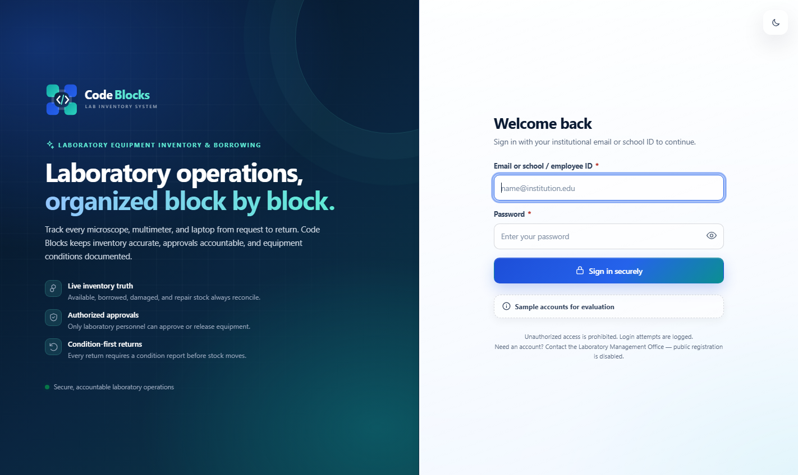 | 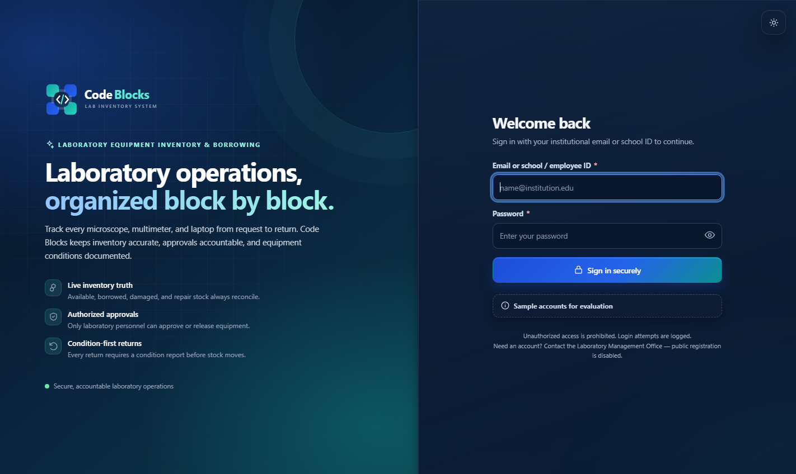 |

### Dashboard

| Light | Dark |
|---|---|
| 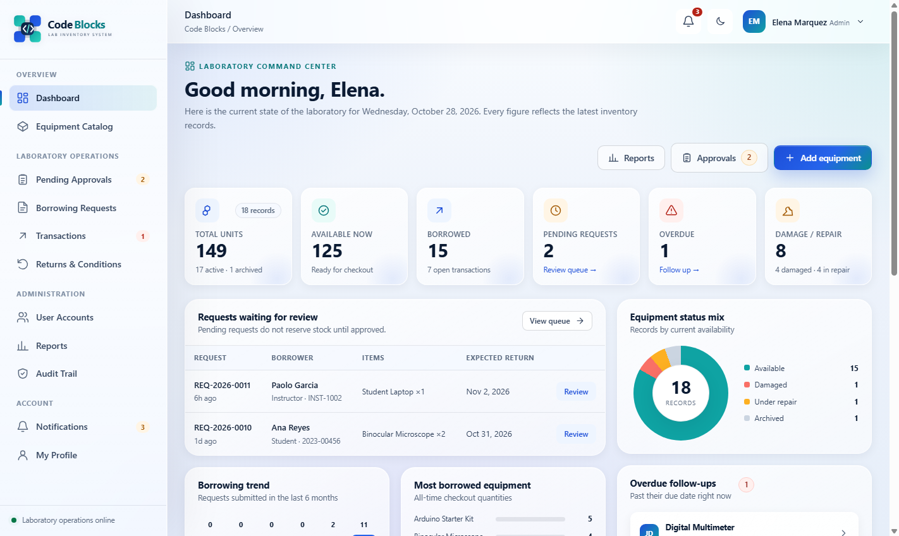 | 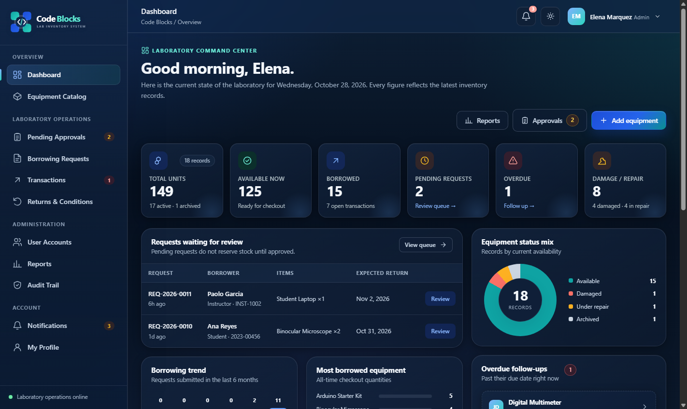 |

### Equipment catalog

| Light | Dark |
|---|---|
| 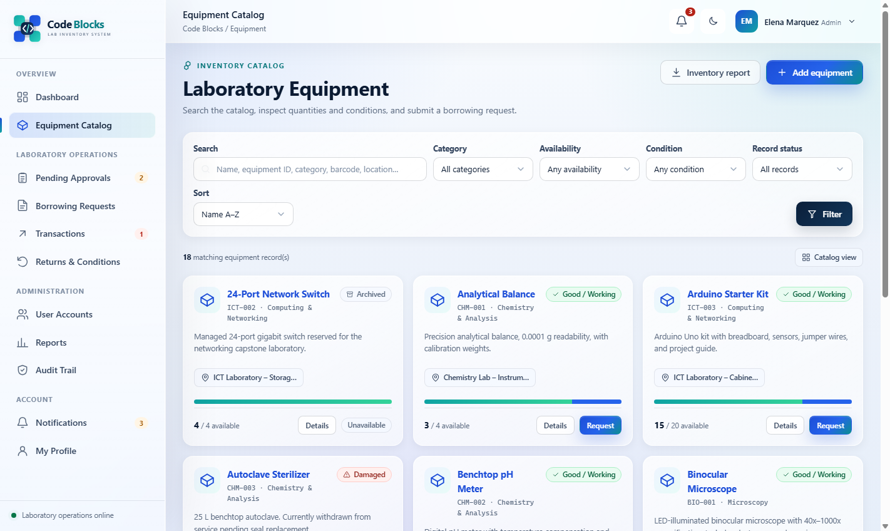 | 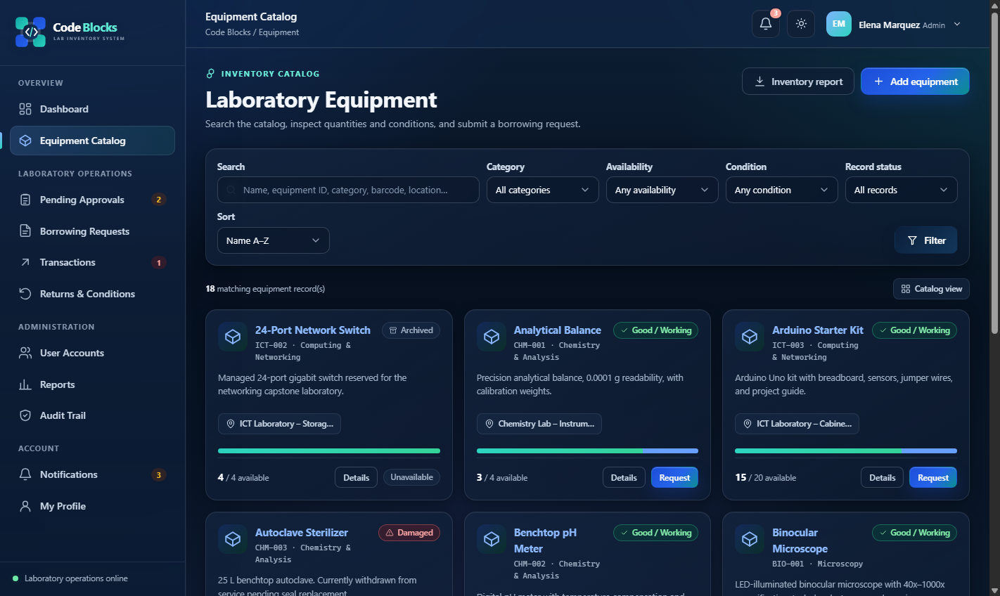 |

### Notifications

| Light | Dark |
|---|---|
| 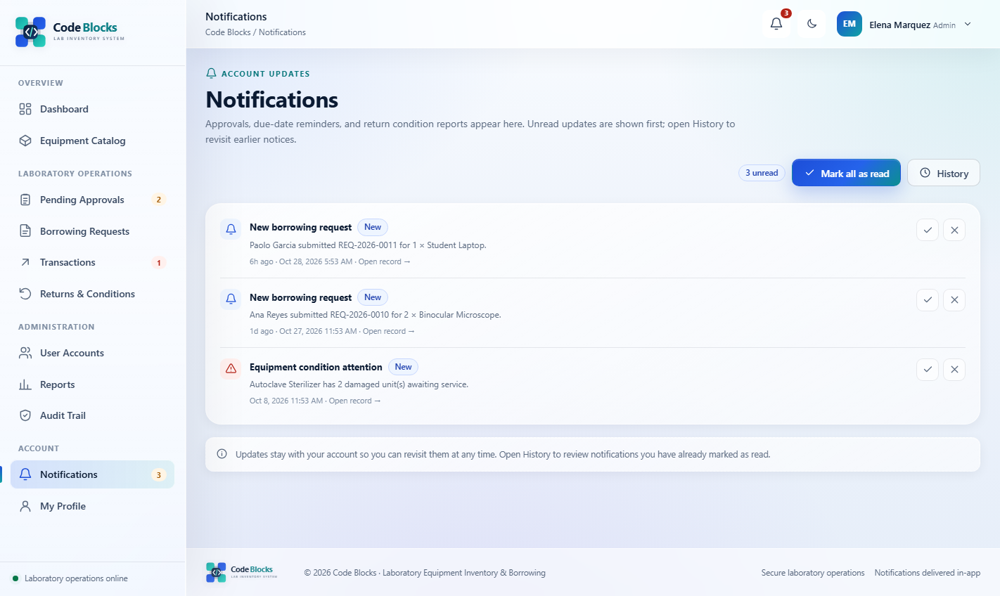 | 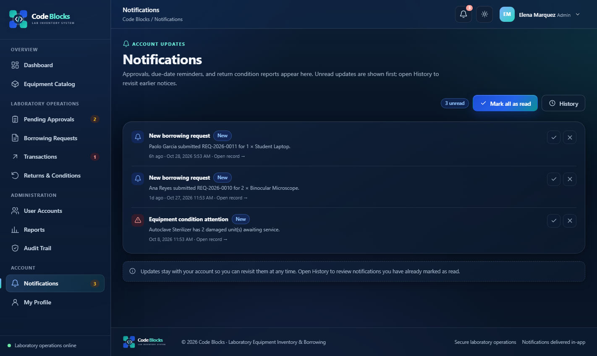 |

### Reports

| Light | Dark |
|---|---|
| 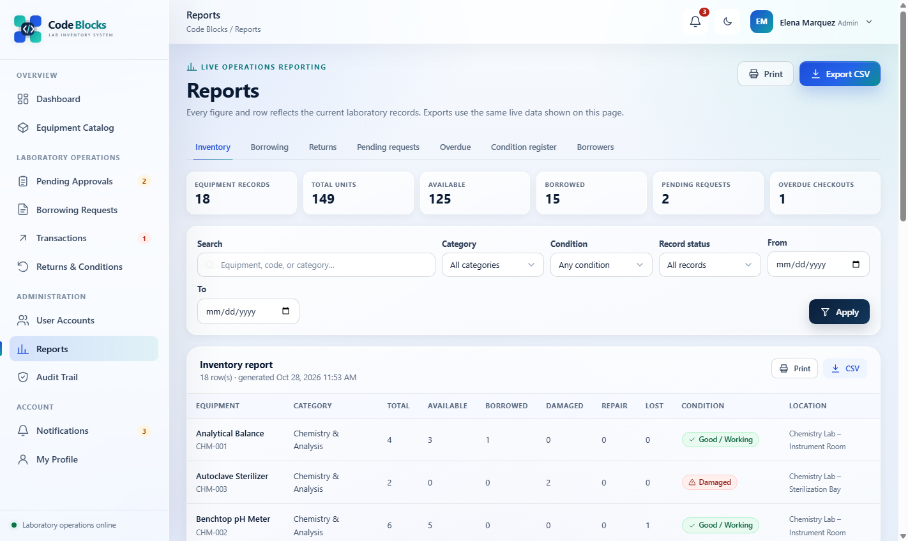 | 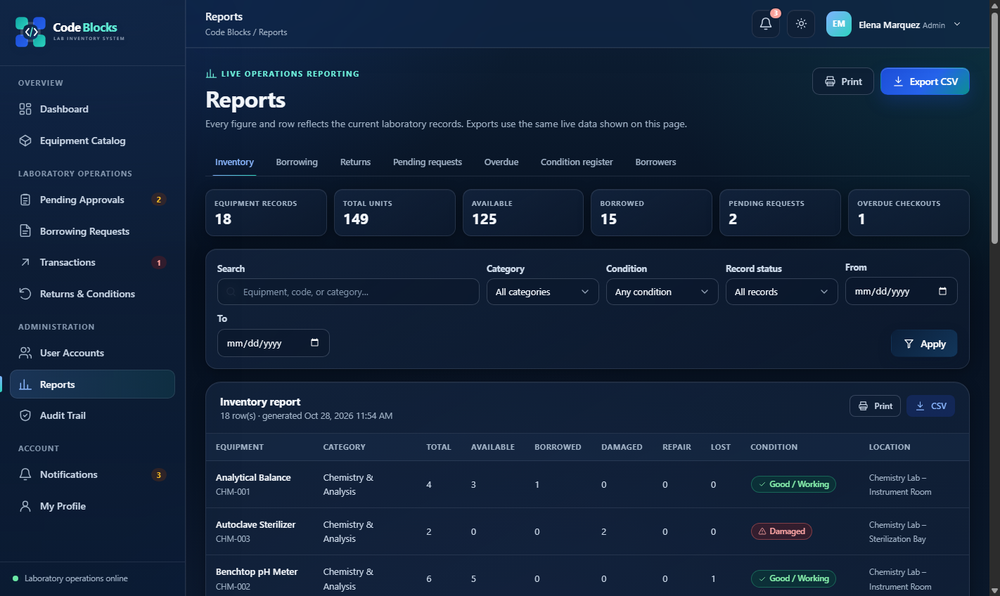 |

### Dialog and menus

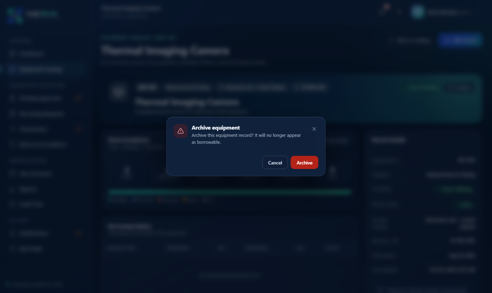
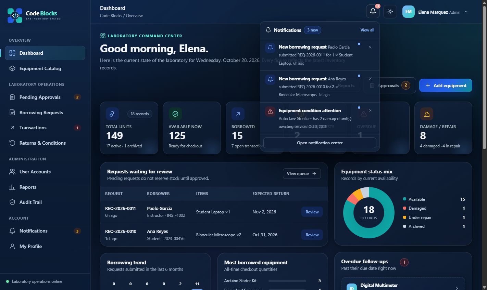
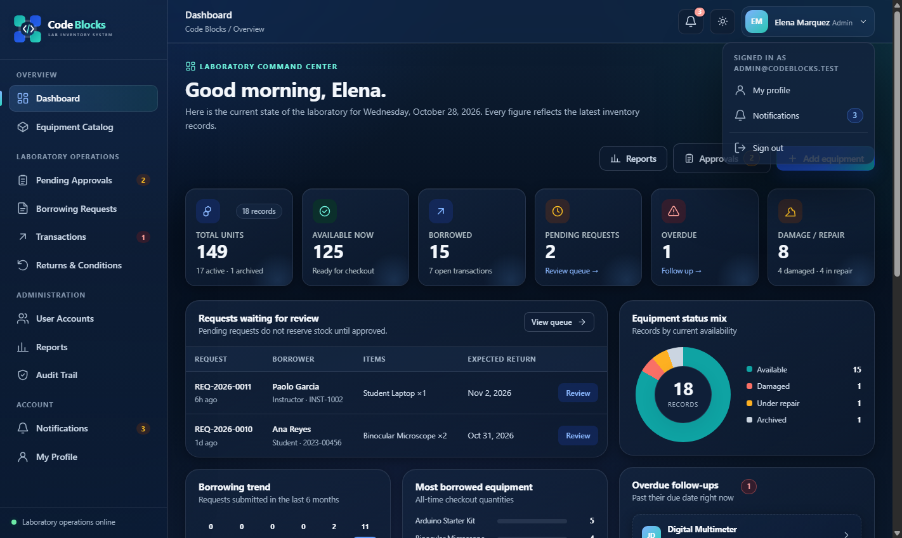

### Tablet and mobile

| Tablet light | Tablet dark |
|---|---|
| 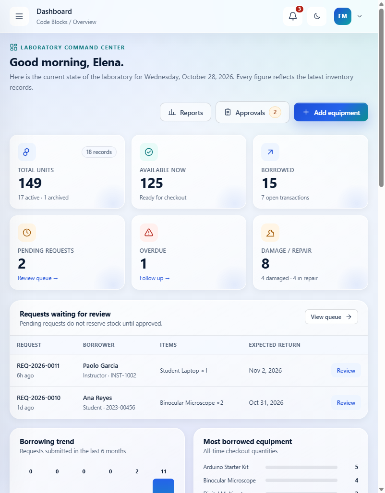 | 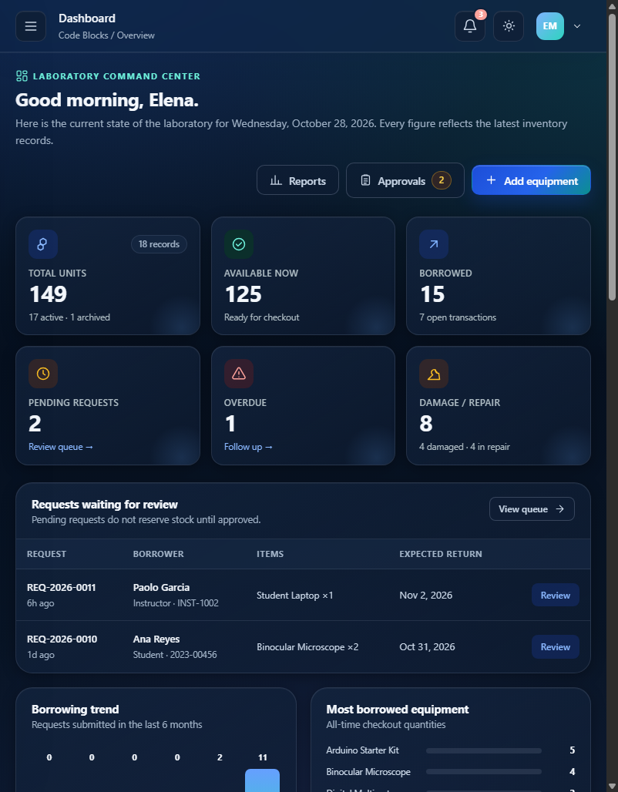 |

| Mobile light | Mobile dark |
|---|---|
| 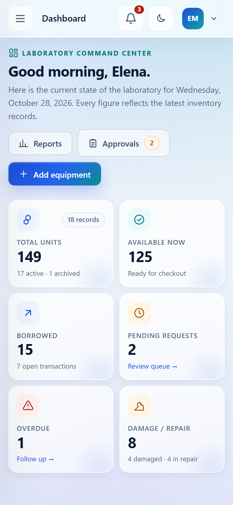 | 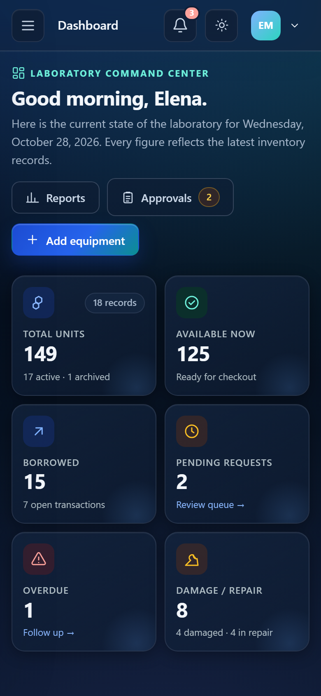 |

Additional mobile views: `mobile-equipment-*`, `mobile-reports-*`,
`mobile-transactions-*`, `mobile-notifications-*`, `mobile-sidebar-dark.png`,
and `mobile-notification-dropdown-dark.png`.

## Verification status

- Both themes checked on login, dashboard, equipment, reports, notifications,
  transactions, profile, forms, audit, and error pages.
- Theme choice persists across reload and login.
- Notification dismiss/read/read-all operations persist in MySQL and update the
  UI without a reload.
- Modal focus trap and Escape close were exercised with keyboard events.
- Desktop, tablet, and 390 px mobile screenshots captured without console
  errors.
- Final Selenium and acceptance evidence is stored under `tests/`.

Items that are not part of the UI layer and are still external to the
repository deliverable are listed in `docs/portfolio-checklist.md`.
